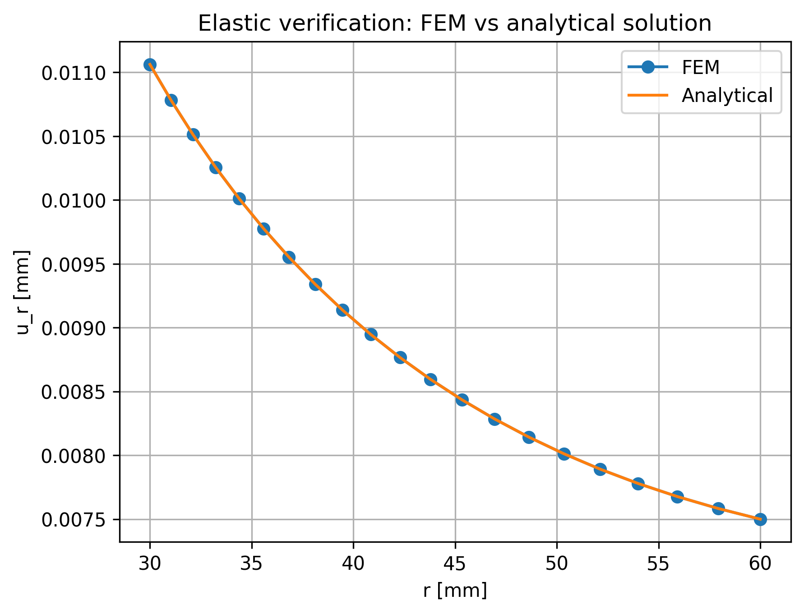
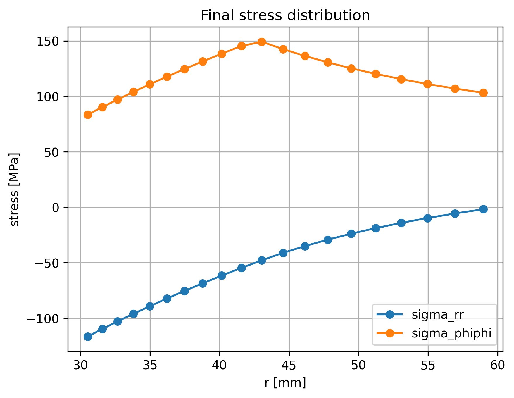
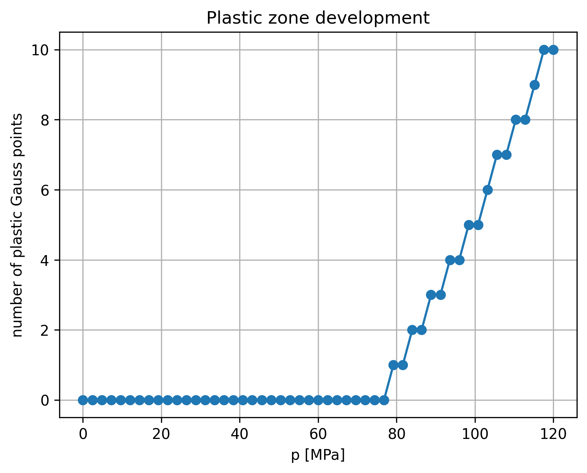
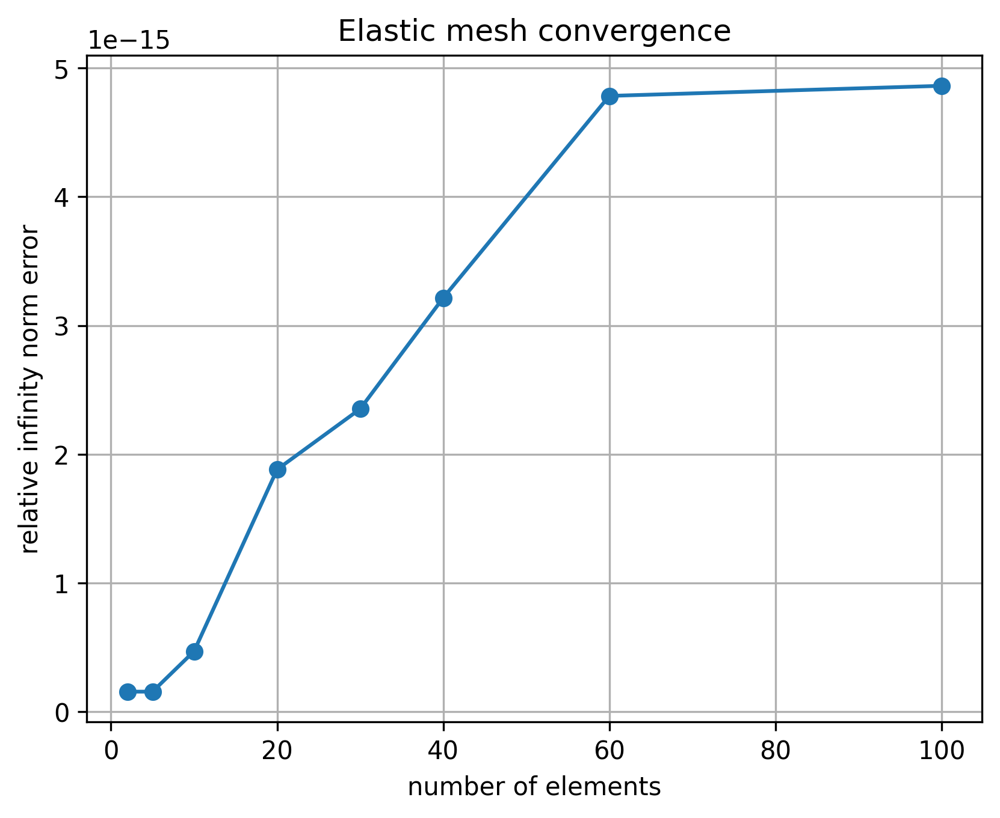
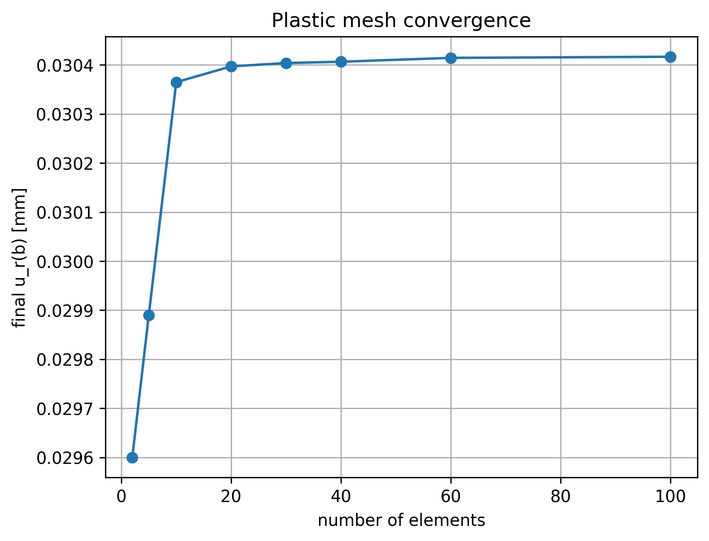
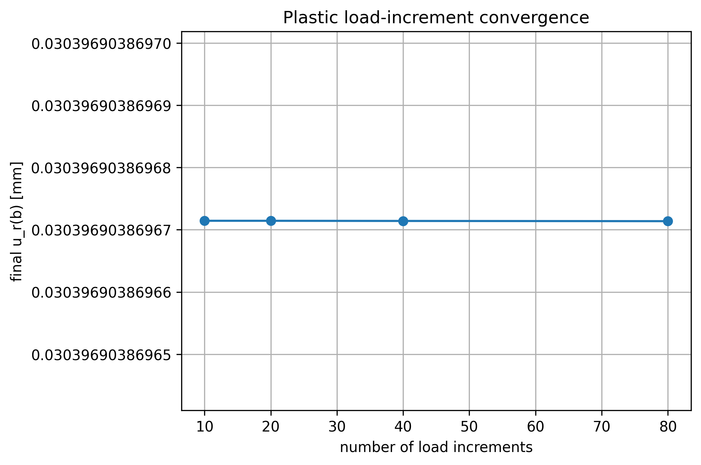

# Nonlinear FEM — Elastic–Plastic Analysis of a Thick-Walled Pipe

**A modular Python implementation of the finite element method for an internally pressurized, axisymmetric thick-walled pipe, featuring graded radial meshing, Tresca ideal plasticity, Newton–Raphson iterations, and numerical verification.**

This repository documents my **Nonlinear Finite Element Methods** coursework project (Summer 2026) in the M.Sc. Computational Materials Science program at **TU Bergakademie Freiberg**. The implementation solves the **axisymmetric radial displacement problem under plane-stress conditions** using two-node linear finite elements. The objective is to implement, study, and verify an elastic–plastic FEM workflow from the element level upward—not to provide a general-purpose FEA program. A [13-page technical report](Nonlinear_FEM_Elastic_Plastic_Analysis_Technical_Report.pdf) accompanies the source code and result plots.

## Contents

- [Highlights](#highlights)
- [Results at a glance](#results-at-a-glance)
- [Technical report](#technical-report)
- [Project background](#project-background)
- [Mathematical and numerical model](#mathematical-and-numerical-model)
- [Implementation architecture](#implementation-architecture)
- [Installation and execution](#installation-and-execution)
- [Verification and convergence](#verification-and-convergence)
- [Output figures](#output-figures)
- [Scope and limitations](#scope-and-limitations)
- [Author](#author)

## Highlights

- **Mesh generation:** locally graded 1D radial finite-element mesh, with smaller elements near the inner wall; adjustable element count and refinement ratio.
- **Discretization:** two-node linear elements, axisymmetric weak form, shape functions and strain–displacement (`B`) matrix, one Gauss point per element.
- **Constitutive model:** plane-stress linear elasticity and **elastic–perfectly plastic Tresca material behavior** with an elastic predictor/plastic corrector and consistent algorithmic tangent.
- **Nonlinear equilibrium:** incremental pressure loading with global **Newton–Raphson iterations** and committed Gauss-point plastic-strain history.
- **Verification:** analytical elastic-solution comparison; mesh-refinement and load-increment convergence studies.
- **Outputs:** radial displacement, radial/hoop stress, Tresca equivalent stress, widening history, plastic-zone development, and convergence figures.

## Results at a glance

### Elastic verification against an analytical solution



The elastic FEM displacement profile is compared with the closed-form solution for a thick-walled pipe at **37.5 MPa**. For the reference 20-element case, the relative infinity-norm displacement error is approximately **1.88 × 10⁻¹⁵** (at the level of floating-point roundoff for this test).

### Elastic–plastic response at maximum pressure





At **120 MPa**, the reference analysis returns a final outer radial displacement of approximately **0.030397 mm**, with **10 of 20** Gauss integration points plastic. The stress and plastic-zone plots illustrate the transition from initially elastic behavior to progressive yielding near the inner wall.

## Technical report

📄 **[Read the full technical report (PDF)](Nonlinear_FEM_Elastic_Plastic_Analysis_Technical_Report.pdf)**

The 13-page report provides the detailed mathematical development and numerical interpretation behind the Python implementation. It covers:

- The axisymmetric equilibrium equation and weak-form derivation.
- Radial finite-element discretization, shape functions, kinematics, and numerical integration.
- Plane-stress elasticity, the Tresca yield criterion, return mapping, and consistent tangent stiffness.
- Element and global assembly, pressure increments, Newton–Raphson iterations, and Gauss-point state variables.
- Analytical elastic verification, mesh and load-increment studies, and elastic–plastic response plots.

The report and the original Python modules describe the same prescribed **plane-stress, one-Gauss-point** coursework variant. The README provides a quick project overview; the PDF contains the full derivations, results, and discussion.

## Project background

This implementation was completed for the **Nonlinear Finite Element Methods** course at **TU Bergakademie Freiberg** during **Summer Semester 2026**, based on an assignment issued by **Dr. Geralf Hütter**.

The assigned problem was an internally pressurized, axisymmetric thick-walled pipe with elastic–ideal-plastic Tresca material behavior. The submitted work required a working numerical FEM implementation, analytical verification of the elastic solution, convergence studies, and technical documentation.

The Python implementation, saved plots, and technical report in this repository present **my work on that assigned problem**. The original university-provided assignment sheet is not redistributed here.

## Mathematical and numerical model

### Problem definition

An internally pressurized, thick-walled pipe has inner radius `a` and outer radius `b`. Its outer surface is traction-free. Under axisymmetry, the primary unknown is the radial displacement `u_r(r)`; the corresponding strain components are

$$
\varepsilon_{rr}=\frac{du_r}{dr}, \qquad
\varepsilon_{\varphi\varphi}=\frac{u_r}{r}.
$$

The radial equilibrium equation is

$$
\frac{d(r\sigma_{rr})}{dr}-\sigma_{\varphi\varphi}=0,
$$

subject to the pressure/traction conditions

$$
\sigma_{rr}(a)=-p, \qquad \sigma_{rr}(b)=0.
$$

The implemented plane-stress constitutive law uses an isotropic elastic modulus matrix and ideal plasticity. For the specified axisymmetric model, the Tresca measure is

$$
\sigma_{\mathrm{eq}}=|\sigma_{rr}-\sigma_{\varphi\varphi}|,
\qquad \Phi=\sigma_{\mathrm{eq}}-\sigma_y\leq0.
$$

When the trial state exceeds the yield condition, a return-mapping correction updates stress and plastic strain. A consistent tangent is used in the global Newton–Raphson equilibrium iterations. State variables are stored at Gauss points and committed after convergence of the pressure increment.

### Reference configuration

| Parameter | Value |
|---|---:|
| Inner radius, `a` | 30 mm |
| Outer radius, `b` | 60 mm |
| Young's modulus, `E` | 200,000 MPa |
| Poisson's ratio, `ν` | 0.30 |
| Yield stress, `σ_y` | 200 MPa |
| Maximum internal pressure, `p_max` | 120 MPa |
| Plane condition | Plane stress |
| Gauss points per element | 1 |
| Reference mesh | 20 radial elements |
| Reference loading | 50 increments |
| Graded mesh size ratio (outer/inner) | 2 |
| Analytical plastic-initiation pressure, `p_init` | 75 MPa |
| Elastic verification pressure | 37.5 MPa |

Parameters and numerical controls are declared in [`input_data.py`](input_data.py). The radial mesh generation and connectivity logic are in [`mesh.py`](mesh.py).

### Discretization and solution procedure

1. Create a graded radial mesh and element connectivity.
2. Construct the element interpolation and strain–displacement relations.
3. Evaluate the elastic or elastic–plastic material response and tangent matrix.
4. Assemble element internal forces and tangent stiffness into the global system.
5. Apply the inner pressure in increments and solve the equilibrium residual by Newton–Raphson iteration.
6. Commit the converged plastic-strain history and proceed to the next increment.
7. Compare against the analytical elastic solution and run convergence studies.

> **Terminology:** “Axisymmetric” describes the physical formulation. The generated computational mesh is **one-dimensional in radius**, not an automatically generated 2D or 3D solid mesh.

## Implementation architecture

The implementation separates material, element, assembly, solver, execution and plotting responsibilities. Elastic and plastic paths have distinct modules.

```text
main_elastic.py / main_plastic.py
              │
              ▼
run_elastic.py / run_plastic.py
              │
              ▼
solver_routine_elastic.py / solver_routine_plastic.py
              │
              ▼
assembly_routine_elastic.py / assembly_routine_plastic.py
              │
              ▼
element_routine_elastic.py / element_routine_plastic.py
              │
              ▼
material_routine_elastic.py / material_routine_plastic.py

Shared modules: input_data.py, mesh.py, kinematics.py
```

```text
.
├── README.md
├── Nonlinear_FEM_Elastic_Plastic_Analysis_Technical_Report.pdf
├── requirements.txt
├── .gitignore
├── input_data.py
├── mesh.py
├── kinematics.py
├── material_routine_elastic.py
├── material_routine_plastic.py
├── element_routine_elastic.py
├── element_routine_plastic.py
├── assembly_routine_elastic.py
├── assembly_routine_plastic.py
├── solver_routine_elastic.py
├── solver_routine_plastic.py
├── run_elastic.py
├── run_plastic.py
├── main_elastic.py
├── main_plastic.py
├── elastic_plots/        # Four saved verification/convergence plots
└── plastic_plots/        # Seven saved response/convergence plots
```

The **15 Python modules are retained from the original project**. GitHub preparation adds documentation, the accompanying technical report, and repository metadata; it does not change or refactor the solver code.

## Installation and execution

The coursework implementation specifies **Python 3.11** with NumPy and Matplotlib.

```bash
python -m pip install -r requirements.txt
```

Run the elastic solution, analytical verification, and elastic mesh study:

```bash
python main_elastic.py
```

Run the pressure-incremental elastic–plastic problem, the plastic mesh study, and the load-increment study:

```bash
python main_plastic.py
```

Both entry points print numerical output and create or update figures in `elastic_plots/` and `plastic_plots/`. The plotting routines call `plt.show()`, so an interactive Python installation may open figure windows. In a non-graphical environment, you can select a non-interactive backend before execution, for example `MPLBACKEND=Agg` on Unix-like systems.

**Runtime note:** The plastic entry point runs several convergence cases in addition to the reference simulation; it takes longer than a single fixed-mesh analysis. Input parameters can be adjusted in `input_data.py`, but the figures and reference values documented here correspond to the supplied configuration.

## Verification and convergence

### Elastic verification

At `p = 37.5 MPa` (below the expected plastic-onset pressure), the FEM nodal displacement is compared against

$$
u_r^{\mathrm{exact}}(r) =
\frac{pa^2}{E(b^2-a^2)}
\left[(1-\nu)r+(1+\nu)\frac{b^2}{r}\right].
$$

| Reference result | Value |
|---|---:|
| FEM inner displacement, `u_r(a)` | 0.0110625 mm |
| FEM outer displacement, `u_r(b)` | 0.0075000 mm |
| Relative infinity-norm displacement error | 1.8817 × 10⁻¹⁵ |
| Reported Newton iterations | 2 |

The output reports two Newton iterations because **both residual and displacement-increment criteria are checked**. In this linear elastic case, the primary correction already reaches the solution; the following correction is negligible. The elastic mesh-study errors are already close to machine precision for the tested configurations, so their small fluctuations should not be interpreted as a conventional asymptotic mesh-convergence rate.



### Elastic–plastic response

The pressure is increased from zero to `p_max = 120 MPa` with the reference 20-element, 50-increment configuration.

| Reference result | Value |
|---|---:|
| Expected initial yielding, `p_init` | 75 MPa |
| Final outer radial displacement, `u_r(b)` | ≈ 0.0303969 mm |
| Plastic Gauss points at final loading | 10 / 20 |

The simulations additionally evaluate radial/hoop stress, equivalent Tresca stress, outward plastic-zone growth, mesh sensitivity, and load-increment sensitivity. The reference load-increment study uses **10, 20, 40 and 80 increments** and reports essentially identical final outer displacement values for those cases.





### Why the full terminal logs are not committed

The original runs also generated detailed text dumps for the elastic and elastic–plastic solvers, plus an unusually verbose educational trace. These **can be reproduced from the Python entry points** and are omitted from the main repository to keep it easy to browse. The key numerical results and the original saved figures are preserved above and in the plot folders.

## Output figures

| Analysis | Figure |
|---|---|
| Elastic | [FEM vs. analytical displacement](elastic_plots/elastic_verification_FEM_vs_analytical.png) |
| Elastic | [Displacement error](elastic_plots/elastic_displacement_error.png) |
| Elastic | [Mesh convergence](elastic_plots/elastic_mesh_convergence.png) |
| Elastic | [Outer displacement convergence](elastic_plots/elastic_outer_displacement_convergence.png) |
| Plastic | [Final radial displacement](plastic_plots/plastic_final_radial_displacement.png) |
| Plastic | [Final radial and hoop stress](plastic_plots/plastic_final_stress_distribution.png) |
| Plastic | [Final Tresca stress](plastic_plots/plastic_final_tresca_stress_distribution.png) |
| Plastic | [Pipe widening history](plastic_plots/plastic_pipe_widening_history.png) |
| Plastic | [Plastic-zone development](plastic_plots/plastic_zone_development.png) |
| Plastic | [Mesh convergence](plastic_plots/plastic_mesh_convergence.png) |
| Plastic | [Load-increment convergence](plastic_plots/plastic_load_increment_convergence.png) |

## Scope and limitations

This is a **coursework-scale educational numerical solver** for the prescribed axisymmetric, plane-stress thick-walled-pipe problem with ideal Tresca plasticity. It demonstrates FEM assembly, material state updates, nonlinear solution, radial mesh refinement and verification for the assigned configuration.

It does **not** provide general 3D FEM, arbitrary imported CAD geometries, automated CAD-to-mesh pipelines, or a certified industrial simulation workflow. Results should not be extrapolated to other material laws or loading cases without additional verification and validation.

The original university assignment sheet is not included. The accompanying [technical report](Nonlinear_FEM_Elastic_Plastic_Analysis_Technical_Report.pdf), reproducible Python modules, and saved figures document the work performed for the course project.

## Author

**Vigneshwara Koka Balaji**  
M.Sc. Computational Materials Science — TU Bergakademie Freiberg, Germany  
NLFEM project — Summer 2026
